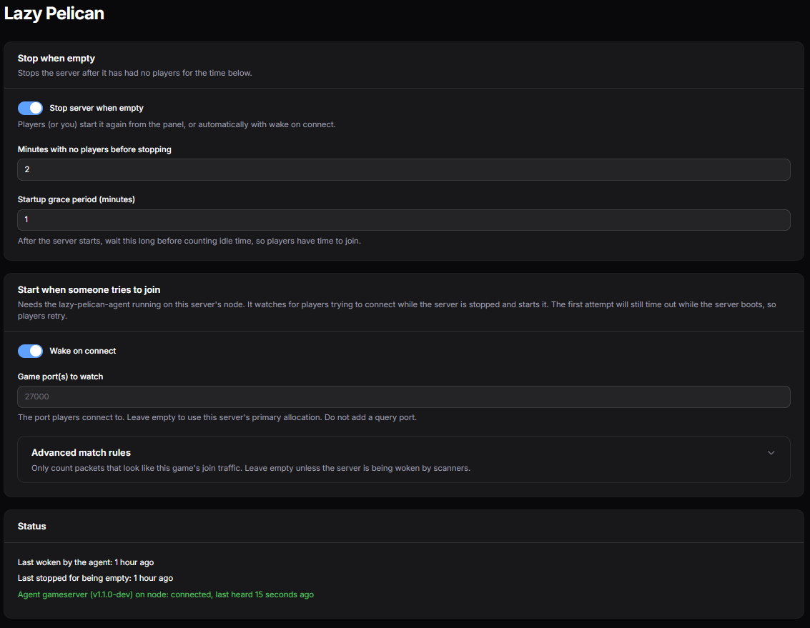

# Lazy Pelican (Pelican plugin)

Lazy server management for Pelican game servers.

- **Sleep:** the plugin stops a server automatically after it has had **no players** for a set time.
- **Wake (optional, experimental):** a small companion program, the [lazy-pelican-agent](agent/README.md), starts a
  stopped server when someone tries to join it.

Without the agent, starting stays manual: players you've added as subusers can press Start in the panel.



## How idle shutdown works
- Every minute a scheduled command (`lazy-pelican:check`) looks at each server that has idle shutdown enabled.
- Player counts come from the **Player Counter** plugin's Game Query for the server's egg
  (A2S/Source for Valheim, the REST API for Palworld; see Games below).
- Not running -> nothing happens. Running -> a startup grace period, then idle time is counted.
- When the player count has been 0 for the idle time, a normal panel `stop` power action is sent
  (Valheim's egg stops with ^C, so the world is saved).
- Fail-safe: if the player count can't be read, the idle timer resets and the server is **not** stopped.

## Requirements
- Pelican panel with the plugin system
- [player-counter](https://hub.pelican.dev/plugins/player-counter) plugin installed, with a Game Query linked to the egg
- The panel's scheduler and queue worker running (`php artisan schedule:run` via cron)

## Setup
1. Install and enable `player-counter`. Admin -> Game Queries -> create a query for your game (see below) and link it
   to the egg. The seeder does not always create these, so check the list.
2. Install this plugin (import the zip on the Plugins page, or copy folder `lazy-pelican` to `plugins/` and run
   `php artisan p:plugin:install`).
3. Open the server -> **Lazy Pelican**, turn on "Stop server when empty" and set the minutes. The page warns you if
   Player Counter or the Game Query is missing.
4. Give subusers the **Lazy Pelican** permission (`lazy_pelican.update`) if they should manage it.


## Games
Lazy Pelican works with any game Player Counter can query. Tested so far:

| Game | Game Query | Needs |
|---|---|---|
| Valheim | **Source**, query port offset **1** | **Public Server must be on** (see below) |
| Palworld | **Palworld**, no offset | REST API enabled on the game port, plus an `ADMIN_PASSWORD` (see below) |

If the player count can't be read, nothing is ever stopped, so a game that isn't set up correctly just never shuts
down. It does not get stopped by mistake.

### Valheim: Public Server must be on
The Valheim server only answers the Steam query when `-public 1`. With Public Server off, the player count is
unavailable and idle shutdown can never stop the server. With a password set, "public" only means the server is
listed in the in-game browser. Use the **Source** query with offset 1 (game port 27000 -> query port 27001), and make
sure the query port is also an allocation on the server so Docker maps it.

### Palworld: enable the REST API
Player Counter reads Palworld through its REST API (`/v1/api/info`, `/metrics`, `/players`), authenticating as `admin`
with the server's `ADMIN_PASSWORD` variable. The REST API listens on the **same port as the game** (TCP, while the game
is UDP), so Player Counter finds it on the server's allocation.

The stock egg uses RCON and does not enable the REST API, but its config tool reads `REST_API_ENABLED` and
`REST_API_PORT`. Without editing the egg, prefix the server's startup command (admin -> server -> Startup) with:

```
export REST_API_ENABLED=True REST_API_PORT={{SERVER_PORT}}; 
```

Check it works from the panel host: `curl -u admin:<ADMIN_PASSWORD> http://<ip>:<port>/v1/api/info`.
Set a non-empty `ADMIN_PASSWORD` on the server, or the query returns nothing.

## Wake on connect (experimental)

> **Experimental.** The agent has been tested on one Wings host with Valheim and Palworld, from one client machine.
> Expect rough edges, and read "Status" below before relying on it.

The plugin on its own only stops servers. Starting one again when a player tries to join needs a small separate program, the
**lazy-pelican-agent**, running on the Wings host, because the panel can't see network traffic. It is not part of the plugin
zip and the plugin works fine without it. If you don't use it, friends with the Start permission can press Start in
the panel instead.

```
player ──UDP──> game port (nothing listening: server is stopped)
                   │  lazy-pelican-agent sees the packets on the host's network interface
                   ▼
        looks like a join attempt?  ──yes──>  panel: is it offline?  ──yes──>  start it
```

The first attempt always times out, because the game takes a minute or more to boot. Players retry. A stopped server
also isn't in any in-game server list, so players join by address. Once it's up, idle shutdown stops it again after
nobody has been on for a while.

**The panel is in charge.** You turn wake on per server in the panel, and the agent asks the panel what to watch. The
agent's own config file is only the panel URL and which node it runs on.

### What you need
- idle shutdown already working on the servers you want (see Setup above).
- A Linux Wings host. The agent runs **on the Docker host next to Wings** (not inside the Wings container), whether
  Wings itself runs under systemd or in Docker. It needs `CAP_NET_RAW` to read packets, nothing else.
- UDP port forwards from your router to the Wings host for each game port. The agent does not go through a reverse
  proxy, and neither does game traffic.

### Setup
**Admin > Lazy Pelican** has all of this with your panel URL and node name filled in, plus the agent's live status.

1. **Create a user for the agent** in the panel (a normal user, **not** an admin). Add it as a subuser on each server
   you want woken, with only the **Control > Start** permission.
2. **Create a client API key as that user.** Log in as the agent's user, open the account menu, then **API Keys**.
   This is the account (client) key, which starts with `pacc_`. It is *not* the admin "Application" key under
   Admin > API Keys, which doesn't work for this. The key is shown once.
3. **Get the agent.** Releases made after the agent was added attach `lazy-pelican-agent_<version>_linux_<amd64|arm64>.tar.gz`
   (binary, example config, systemd unit, compose file, `install.sh`) and a `SHA256SUMS` file; a container image is published to
   `ghcr.io/dylf/lazy-pelican-agent`. Neither has been published yet, so for now build it yourself:
   `cd agent && go build -o lazy-pelican-agent ./cmd/lazy-pelican-agent`.
4. **Write the config** (copy `agent/deploy/config.example.yml`). This is all it needs:
   ```yaml
   panel_url: https://panel.example.com
   node: node                       # this host's node in the panel (id, name or FQDN)
   ignore_sources: [10.0.0.50]     # the panel's own LAN address, if the panel is on your network
   ```
   Give the key through the environment (`LAZY_PELICAN_API_KEY`), not the file.
5. **Check it:** `lazy-pelican-agent doctor -config config.yml`. It verifies the key, the Start permission, packet capture,
   and lists the servers the panel wants watched, without starting anything.
6. **Turn on "Wake on connect"** for a server, on its **Lazy Pelican** page. The game port defaults to the server's
   primary allocation; change it there if needed (never the query port). The agent picks the change up within a minute.
7. **Dry run:** `lazy-pelican-agent run -config config.yml -dry-run -v`. Try to join a stopped server and watch for
   `dry run: would start the server`. Nothing is started.
8. **Run it for real**, as a systemd service or a container. On bare metal, `sudo ./install.sh` from the release
   directory does steps 4 to 5 and installs and starts the service. See [agent/README.md](agent/README.md) for the
   details and the compose example.

**Is it working?** The agent reports in every 30 seconds. **Admin > Lazy Pelican** lists each agent with its status
(connected or not responding), whether packet capture works, its version and the user behind its key, and shows per
server whether anything can wake it: an agent is connected for the node, it can capture packets, and its user may
start the server. The same lines appear on the server's own Lazy Pelican page. Offline agents have a **Remove**
button there, and agents not heard from for 7 days (setting: "Forget agents not heard from for") are removed
automatically; a running agent simply reappears on its next heartbeat. It can't see your router, so port
forwards still need checking by hand. Each wake is recorded in the server's activity log.

**More than one node?** Set `node:` on each agent, so it only watches servers on its own host.

**Settings** (Admin > Plugins > Lazy Pelican > Settings): the join detection thresholds, the cooldown and the hourly
cap are set in the panel and sent to the agent. You can still override any of them, or list `servers:` by hand, in the
agent's config file; the local file wins. If the panel is unreachable the agent keeps the last config it received.

How the agent decides what counts as a join attempt, what it tested against and its limits are in
[agent/README.md](agent/README.md).

### Limits
- Linux only, IPv4 only, UDP only. Games that join through a relay or peer to peer (such as Valheim crossplay) can't
  be woken. See [agent/README.md](agent/README.md#limits).
- Valheim must have **Public Server** on for idle shutdown to read its player count (see Games above). That also lists
  the server publicly while it's running.

## Config (env)
| Variable | Default |
|---|---|
| `LAZY_PELICAN_DEFAULT_IDLE_MINUTES` | 15 |
| `LAZY_PELICAN_DEFAULT_GRACE_MINUTES` | 10 |
| `LAZY_PELICAN_VERBOSE` | false |

The wake and agent settings (join detection thresholds, cooldown, hourly cap, agent retention) live in
Admin > Plugins > Lazy Pelican > Settings.

